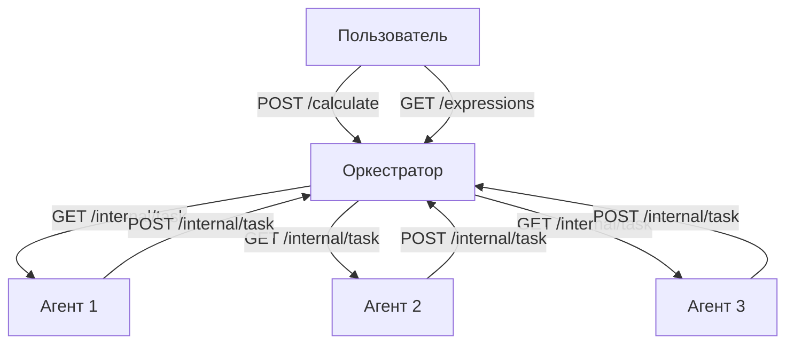

# Распределённый вычислитель арифметических выражений(Финал)

Система для параллельного вычисления сложных арифметических выражений с использованием оркестратора и агентов-вычислителей.

## Установка

1. **Клонируйте репозиторий**:
    ```
    git clone https://github.com/IvanSolomatin/calc_v2
    ```

2. **Убедитесь, что установлен go 1.23.1+**:
    ```
    go version
    ```

3. **Перейдите в корневую папку проекта**:

4. **Установка зависимостей**:
    ```
    go mod tidy
    ```


---

## Архитектура



**Оркестратор** :

- Принимает выражения через REST API
- Разбивает выражения на простые задачи
- Управляет очередью задач
- Собирает результаты
- Хранит вычисления

**Агенты**:

- Получают задачи от оркестратора(связь c оркестратором через grpc)
- Выполняют арифметические операции с задержкой(задается пользователем через переменные среды)
- Возвращают результаты оркестратору

## Возможности

- Поддерживаемые операции: `+`, `-`, `*`, `/`
- Приоритет операций и скобки
- Параллельное выполнение операций(если количество запущенных агентов больше 1)

# Запуск 

go run ./cmd/main.go

## Windows (cmd.exe)


### Установка переменных среды
- set HTTP_PORT=8080 //порт HTTP
- set GRPC_PORT=50051 //порт GRPC
- set COMPUTING_POWER=1 //количество агентов
- set TIME_ADDITION_MS=100 //время сложения
- set TIME_SUBTRACTION_MS=100 //время вычитания
- set TIME_MULTIPLICATIONS_MS=100 //время умножения
- set TIME_DIVISIONS_MS=100 //время деления
- set TIME_TIMEOUT_MS=100//частота опроса агентами
- здесь пример значений которые установлены по умолчанию


### Пример conf.env файла(он уже есть, можете его просто редактировать)
TIME_ADDITION_MS=100

TIME_SUBTRACTION_MS=150

TIME_MULTIPLICATION_MS=200

TIME_DIVISION_MS=250

GRPC_PORT=50051

HTTP_PORT=8080

COMPUTING_POWER=1

TIME_TIMEOUT_MS=200

## API Endpoints
###  Авторизация

```bash
регистрация
curl -X POST http://localhost:8080/api/v1/register   -H "Content-Type: application/json"   -d '{"login":"user2", "password":"password1234"}'  
```
Успешный ответ (201):

```bash
вход
curl -X POST http://localhost:8080/api/v1/login   -H "Content-Type: application/json"   -d '{"login":"user2", "password":"password1234"}' 
```
Успешный ответ:
{"token":"YOUR_TOKEN"}

### 1. Добавление выражения

Пример запроса:

```bash
curl -X POST http://localhost:8080/api/v1/calculate   -H "Content-Type: application/json"   -H "Authorization: YOUR_TOKEN"   -d '{"expression":"2+2*2"}'
```
Успешный ответ (201):
```json
{"id":"id"}
```

### 2. Получение списка выражений
```bash
 curl -X GET http://localhost:8080/api/v1/expressions   -H "Authorization: YOUR_TOKEN"  
```

Пример ответа (200):

```json
[{"id":"id","expression":"2+2*2","status":"completed","result":6,"created_at":"2025-05-11T13:05:01Z"}]

```

### 3. Получение выражения по ID

Пример запроса:

```bash
 curl -X GET http://localhost:8080/api/v1/expressions/expr_2_2   -H "Authorization: YOUR_TOKEN"
```

Ответ (200):

```
{"id":"id","expression":"2/0","status":"error","created_at":"2025-05-11T13:19:16Z"}
```

## Примеры сценариев

### Сценарий 1: Успешное вычисление
bash

```bash
curl -X POST http://localhost:8080/api/v1/calculate   -H "Content-Type: application/json"   -H "Authorization: YOUR_TOKEN"   -d '{"expression":"2+2*2"}'
```
# Проверка статуса
```bash
 curl -X GET http://localhost:8080/api/v1/expressions   -H "Authorization: YOUR_TOKEN"  
```

# Ответ 
```json
[{"id":"id","expression":"2+2*2","status":"completed","result":6,"created_at":"2025-05-11T13:05:01Z"}]

```

### Сценарий 2: Ошибка деления на ноль
WINDOWS(cmd)

```bash
curl -X POST http://localhost:8080/api/v1/calculate   -H "Content-Type: application/json"   -H "Authorization: YOUR_TOKEN"   -d '{"expression":"2/0"}'
```

# Ответ:
```json
[{"id":"id","expression":"2/0","status":"error","created_at":"2025-05-11T13:05:01Z"}]

```

## Тестирование


```cmd
go test -v ./internal/app

```


