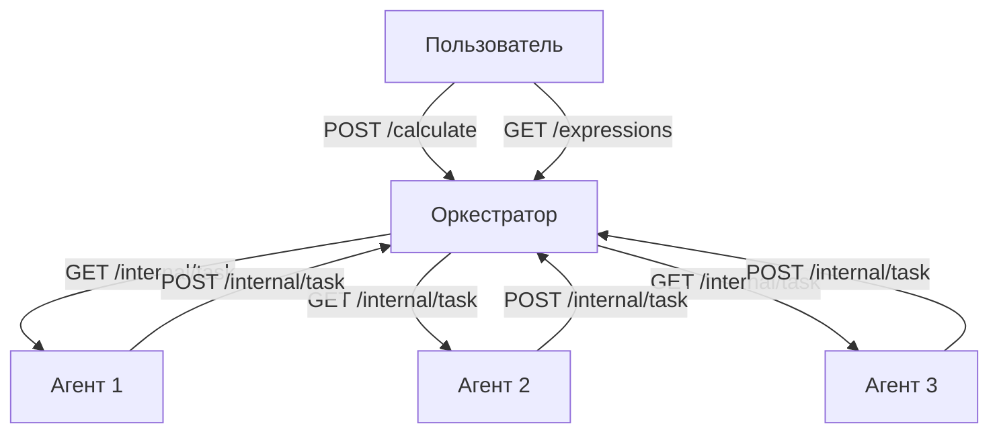

# Распределённый вычислитель арифметических выражений

Система для параллельного вычисления сложных арифметических выражений с использованием оркестратора и агентов-вычислителей.

## Установка и настройка

1. **Клонируйте репозиторий**:
    ```
    git clone https://github.com/IvanSolomatin/calc_v2
    ```

2. **Убедитесь, что установлен go 1.23.1+**:
    ```
    go version
    ```

3. **Перейдите в коренвую папку проекта**:


---

## Архитектура



**Оркестратор** :

- Принимает выражения через REST API
- Разбивает выражения на простые задачи
- Управляет очередью задач
- Собирает результаты
- Хранит вычисления

**Агенты**:

- Получают задачи от оркестратора
- Выполняют арифметические операции с задержкой(задается пользователем через переменные среды)
- Возвращают результаты оркестратору

## Возможности

- Поддерживаемые операции: `+`, `-`, `*`, `/`
- Приоритет операций и скобки
- Параллельное выполнение операций(если количество запущенных агентов больше 1)

# Запуск 

go run cmd/main.go

## Windows (cmd.exe)


### Установка переменных среды

- set PORT= 8082 //порт
- set COMPUTING_POWER=1 //количество агентов
- set TIME_ADDITION_MS=100 //время сложения
- set TIME_SUBTRACTION_MS=100 //время вычитания
- set TIME_MULTIPLICATIONS_MS=100 //время умножения
- set TIME_DIVISIONS_MS=100 //время деления
- здесь пример значений которые установлены по умолчанию


## API Endpoints

### 1. Добавление выражения

Пример запроса:

```bash
curl --location 'http://localhost:8082/api/v1/calculate' \
--header 'Content-Type: application/json' \
--data '{
  "expression": "(2+3)*4-10/2"
}'
```
WINDOWS(cmd)
```
curl -X POST "http://localhost:8082/api/v1/calculate" ^ -H "Content-Type: application/json" ^ -d "{\"expression\": \"2*2+2*2+2*2+2*2+2*2+2*2+2*2+2*2\"}"
```
Успешный ответ (201):

```json
{
    "id": "1"
}
```

### 2. Получение списка выражений
```bash
curl http://localhost:8082/api/v1/expressions
```

Пример ответа (200):

```json
{
    "expressions": [
        {
            "id": "1",
            "expression": "2+2",
            "status": "completed",
            "result": 4
        },
        {
            "id": "1",
            "expression": "2+2+2+2+2+2++2+2++2+2++2+2++2+2",
            "status": "processing",
        },
        {
            "id": "2",
            "expression": "8/0",
            "status": "error",
        }
    ]
}
```

### 3. Получение выражения по ID

Пример запроса:

```bash
curl http://localhost:8082/api/v1/expressions/1
```

Ответ (200):

```json
{
    "id": "1",
    "expression": "2*2+2*2+2*2+2*2+2*2+2*2+2*2+2*2+2*2+2*2+2*2+2*2+2*2+2*2+2*2+2*2+2*2+2*2+2*2+2*2+2*2+2*2+2*2",
    "status": "completed",
    "result": 92
}

{
    "id": "2",
    "expression": "2*2+2*2+2*2+2*2+2*2+2*2+2*2+2*2+2*2+2*2+2*2+2*2+2*2+2*2+2*2+2*2+2*2+2*2+2*2+2*2+2*2+2*2+2*2",
    "status": "processing"
}
```

## Внутреннее API (для агентов, не для пользователя)

### 1. Получение задачи

```curl
curl http://localhost:8082/internal/task
```

Пример ответа (200):

```json
{
    "id":"1",
    "arg1":2,
    "arg2":2,
    "operation":"*",
    "operationtime":100
}
```

### 2. Отправка результата
WINDOWS(cmd)
```bash
C:\Users\Иван>curl -X POST "http://localhost:8082/internal/task" ^ -H "Content-Type: application/json" ^ -d "{\"id\": \"51\", \"result\": 4}"
```

Пример запроса:

```
    200 - успешно записан результат
```


## Примеры сценариев

### Сценарий 1: Успешное вычисление
WINDOWS(cmd)

```bash
curl -X POST "http://localhost:8082/api/v1/calculate" ^ -H "Content-Type: application/json" ^ -d "{\"expression\": \"1/1\"}"
```
# Проверка статуса
curl http://localhost:8080/api/v1/expressions

# Ответ 
```
 "expressions": {
        "1": {
            "id": "1",
            "expression": "1\1",
            "status": "completed",
            "result": 1
        }
 }
```

### Сценарий 2: Ошибка деления на ноль
WINDOWS(cmd)

```curl
curl -X POST "http://localhost:8082/api/v1/calculate" ^ -H "Content-Type: application/json" ^ -d "{\"expression\": \"1/0\"}"
```

# Ответ:
```
 "expressions": {
        "1": {
            "id": "1",
            "expression": "1\0",
            "status": "completed",
        }
 }
```

## Тестирование
Перед тестированием надо убрать переменные среды, так как тест рассчитан(по времени) на работу с стандартными значениями

```cmd
go test .\internal\app\ -v
```