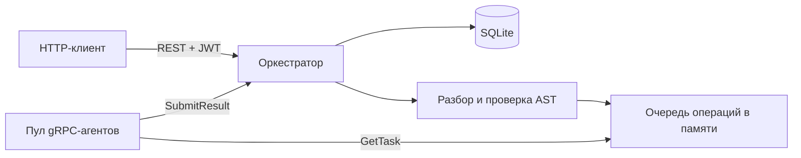

# Go Calc — веб-калькулятор с REST API и gRPC-агентами

Учебный backend на Go: пользователь отправляет арифметическое выражение через HTTP,
оркестратор разбирает его на операции, передаёт их пулу агентов по gRPC и сохраняет
результат в SQLite. Проект демонстрирует REST API, конкурентную обработку задач,
аутентификацию JWT, работу с SQL и автоматическую проверку кода.

## Возможности

- `+`, `-`, `*`, `/`, скобки, унарные `+`/`-`, десятичные числа и научная запись (`1e2`).
- Обычный приоритет операций и левая ассоциативность: `2+2*2 = 6`, `3-2-1 = 0`.
- Числа с ведущими нулями считаются десятичными: `010 = 10`.
- Регистрация, bcrypt-хеширование паролей, JWT HS256 со сроком действия 24 часа.
- Асинхронные вычисления со статусами `processing`, `completed`, `error`.
- Пользователь видит только собственные выражения и результаты.
- Настраиваемый пул агентов и задержки операций, завершение по SIGINT/SIGTERM.
- Table-driven тесты и интеграционные проверки с настоящими SQLite и gRPC.

## Архитектура



В одном процессе запускаются HTTP-сервер, внутренний gRPC-сервер и агенты.
Оркестратор вычисляет зависимости в дереве последовательно; разные выражения
обрабатываются конкурентно. Параллельное исполнение независимых ветвей одного
выражения пока не реализовано. Перед отправкой агенту оркестратор проверяет
арифметическую операцию на деление на ноль и переполнение.

```text
cmd/calculator/          точка входа, окружение и сигналы
internal/app/
  server.go             конфигурация, запуск и завершение серверов
  orchestrator.go       REST, авторизация и очередь задач
  expression.go         десятичные числа, проверка AST и вычисление
  agent.go              пул агентов и арифметические операции
  database.go           схема и подключение SQLite
  *_test.go             unit- и интеграционные тесты
api/calc.proto          контракт gRPC
api/calc/               сгенерированный Go-код protobuf/gRPC
.github/workflows/      build, vet, race-тесты, govulncheck и Docker build
```

## Быстрый запуск

Нужны Go 1.26+, C-компилятор (GCC/Clang) для `go-sqlite3` и Git.
На Debian/Ubuntu C-инструменты устанавливаются пакетом `build-essential`.

```bash
git clone https://github.com/fufelshmerc-corparate/go_calc.git
cd go_calc
# Сгенерируйте собственный секрет; он не должен попадать в Git.
export JWT_SECRET="$(openssl rand -hex 32)"
go run ./cmd/calculator
```

HTTP доступен на `http://localhost:8080`. `conf.env` загружается при запуске,
но уже заданные переменные окружения имеют приоритет. В репозитории нет
готового JWT-секрета: без `JWT_SECRET` длиной не менее 32 байт запуск завершается ошибкой.
Сохраняйте секрет между перезапусками, если нужны ранее выданные токены.

| Переменная | По умолчанию | Назначение |
| --- | --- | --- |
| `JWT_SECRET` | обязательна | Ключ подписи JWT, минимум 32 байта |
| `HTTP_PORT` | `8080` | HTTP-порт, 1–65535 |
| `GRPC_PORT` | `50051` | Внутренний порт на `127.0.0.1`, 1–65535 |
| `DATABASE_PATH` | `data.db` | Файл SQLite |
| `COMPUTING_POWER` | `1` | Число агентов, 1–128 |
| `TIME_TIMEOUT_MS` | `100` | Интервал опроса очереди, 1–60000 мс |
| `TIME_ADDITION_MS` | `100` | Задержка сложения, 0–1000 мс |
| `TIME_SUBTRACTION_MS` | `100` | Задержка вычитания, 0–1000 мс |
| `TIME_MULTIPLICATION_MS` | `100` | Задержка умножения, 0–1000 мс |
| `TIME_DIVISION_MS` | `100` | Задержка деления, 0–1000 мс |

Остановка: `Ctrl+C`. Ошибки конфигурации, БД и занятые порты приводят к ненулевому коду выхода.

## API и примеры curl

Все пути начинаются с `/api/v1`. Примеры рассчитаны на Bash; для автоматического
извлечения полей ответа нужен `jq`. Успешные запросы возвращают HTTP `200`.
Тела успешных ответов — JSON, кроме регистрации (`OK`); ошибки — текст UTF-8.

### Регистрация и вход

```bash
curl -i http://localhost:8080/api/v1/register \
  -H 'Content-Type: application/json' \
  -d '{"login":"demo","password":"demo-password-123"}'

TOKEN=$(curl -fsS http://localhost:8080/api/v1/login \
  -H 'Content-Type: application/json' \
  -d '{"login":"demo","password":"demo-password-123"}' | jq -r .token)
```

Вход возвращает `{"token":"Bearer eyJ..."}`. Значение `TOKEN` уже содержит `Bearer `:
его нужно целиком передать в заголовке `Authorization`. Повторная регистрация
возвращает `409`, неверный пароль — `401`. Пароль ограничен 72 байтами (bcrypt).

### Отправка выражения

```bash
ID=$(curl -fsS http://localhost:8080/api/v1/calculate \
  -H 'Content-Type: application/json' -H "Authorization: $TOKEN" \
  -d '{"expression":"-(2+2)*2 + 1e1"}' | jq -r .id)
echo "$ID"
```

Ответ: `{"id":"<32 hex символа>"}`. Вычисление продолжается в фоне.

### Получение результата и списка

```bash
curl -fsS "http://localhost:8080/api/v1/expressions/$ID" \
  -H "Authorization: $TOKEN"

curl -fsS http://localhost:8080/api/v1/expressions \
  -H "Authorization: $TOKEN"
```

После завершения первое выражение возвращает, например:

```json
{"id":"...","expression":"-(2+2)*2 + 1e1","status":"completed","result":2,"created_at":"2026-11-04T12:00:00Z"}
```

До завершения статус — `processing`, поле `result` отсутствует.
Список без выражений — `[]`. Чужой или неизвестный ID возвращает `404`.

### Ошибки выражений

```bash
# Запрос принят (200), затем статус error: деление на ноль.
curl -fsS http://localhost:8080/api/v1/calculate \
  -H 'Content-Type: application/json' -H "Authorization: $TOKEN" \
  -d '{"expression":"1/(2-2)"}'

# Синтаксис отклонён сразу (422), запись в БД не создаётся.
curl -i http://localhost:8080/api/v1/calculate \
  -H 'Content-Type: application/json' -H "Authorization: $TOKEN" \
  -d '{"expression":"2%1"}'
```

| Код | Причина |
| --- | --- |
| `400` | Некорректный JSON, неизвестные поля, лишние JSON-объекты или недопустимые учётные данные при регистрации |
| `401` | Неверные учётные данные при входе, отсутствующий, просроченный или недействительный JWT |
| `404` | Выражение не найдено у текущего пользователя |
| `405` | Неподдерживаемый HTTP-метод |
| `409` | Логин уже зарегистрирован |
| `422` | Пустое, слишком сложное или синтаксически неверное выражение |
| `500` | Ошибка БД или другая внутренняя ошибка |
| `503` | Уже выполняются 128 выражений или сервер завершает работу |

Деление на ноль, переполнение `float64` и превышение 30-секундного времени
вычисления дают статус `error` без `result`; подробности записываются в лог сервера.

## Сборка и проверки

```bash
make build               # bin/calculator
make check               # форматирование, mod verify, build, vet, race-тесты
make test                # go test -race -timeout 120s ./...
go test -cover ./...
go run golang.org/x/vuln/cmd/govulncheck@v1.9.0 ./...
```

CI выполняет проверки на Go 1.26 и 1.27 и отдельно собирает Docker-образ.
Проверяются арифметика, разбор выражений, отмена задач, JWT, валидация конфигурации,
HTTP-ошибки, уникальность логина, доступ к результатам и жизненный цикл сервера.

## Docker

```bash
docker build -t go-calc .
# JWT_SECRET должен быть задан, как в разделе запуска.
docker run --rm --name go-calc -p 8080:8080 \
  -e JWT_SECRET -v go-calc-data:/data go-calc
```

Образ собирается с CGO и запускается от UID/GID `10001`, без root.
SQLite хранится в volume `/data`; внутренний gRPC наружу не публикуется.
При bind mount каталог должен быть доступен на запись UID `10001`.

## Ограничения и дальнейшее развитие

Это учебный проект, рассчитанный на один экземпляр процесса с локальными агентами.
Очередь не сохраняется: после перезапуска незавершённые выражения помечаются `error`.
Повторная доставка задания при падении агента не реализована; ожидание ограничено
30 секундами. Список выражений пока не имеет пагинации.

Используется `float64`, поэтому возможна обычная погрешность двоичной арифметики;
JSON ограничен 8 КиБ, одновременно выполняются максимум 128 выражений; 
выражение ограничено 4096 байтами, 512 узлами и глубиной AST 64. Имена, функции, комментарии,
шестнадцатеричные числа и операторы за пределами `+ - * /` не поддерживаются.

HTTP не включает TLS и ограничение частоты запросов; для публичного размещения
нужен reverse proxy с HTTPS и rate limiting. gRPC доверяет локальным агентам
и намеренно доступен только на loopback. Следующие шаги: постоянная очередь,
пагинация и параллельная обработка независимых ветвей AST.
